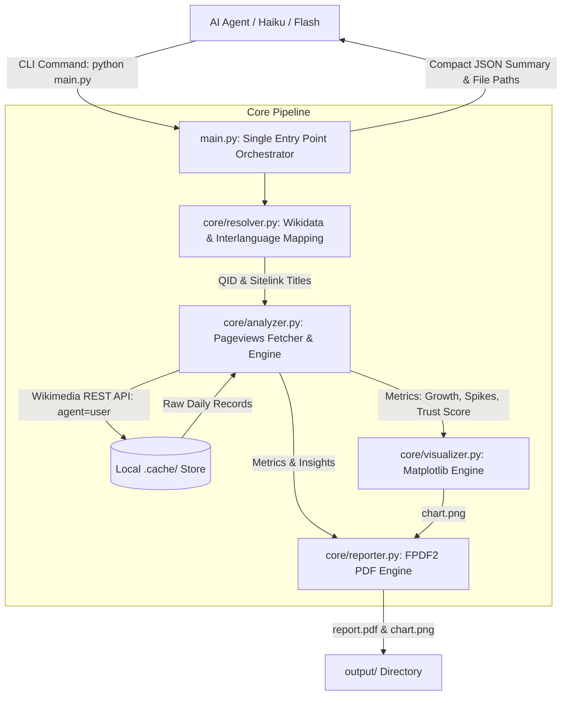

# System Architecture: Wiki Market Analyst

## 1. Overview & Business Objective

`wiki-market-analyst` is an autonomous AI agent skill built in compliance with the [Agent Skills Specification](https://agentskills.io/specification). Its purpose is to provide B2C product founders, product managers, and growth teams with data-grounded market intelligence derived from Wikimedia readership behavior.

The tool solves three critical pain points:
1. **Cross-Language Disconnect:** Automates semantic mapping across language editions via Wikidata QIDs, eliminating 404 errors caused by language guessing.
2. **Signal Noise vs True Intent:** Filters web scrapers, distinguishes viral one-off PR spikes from sustainable baseline growth, and scores data reliability (0–100%).
3. **Execution Efficiency for Fast LLMs:** Provides a unified Single Entry Point CLI that handles heavy data processing locally and returns a compact (~350 token) JSON summary with presentation-ready charts and an executive 1-page PDF.

---

## 2. High-Level Architecture & Data Flow

---

## 3. Core Component Breakdown

### 3.1. Entity Resolver (`core/resolver.py`)
- **Wikidata Search (`wbsearchentities`):** Resolves free-form natural language queries in any language (Ukrainian, English, etc.) to canonical Wikidata Entities (QIDs).
- **Sitelink Extraction (`wbgetentities`):** Fetches the exact corresponding Wikipedia article title for all requested language editions (e.g., `cswiki` -> `Přerušovaný půst`, `ukwiki` -> `Інтервальне голодування`).
- **Direct Search Fallback (`search_wiki_fallback`):** When a language lacks an exact Wikidata sitelink, the module queries that language's Wikipedia Action API directly. It differentiates between close topic matches and mere passing mentions, flagging missing articles explicitly as content voids.

### 3.2. Analytics & Reliability Engine (`core/analyzer.py`)
- **Bot Traffic Exclusion:** All requests explicitly set `agent=user` and `access=all-access` in the Wikimedia Pageviews API, eliminating web scrapers, search engine crawlers, and automated bots.
- **Local Cache Layer:** Caches daily responses in `.cache/` to ensure lightning-fast execution on iterative queries.
- **Statistical Smoothing & Metrics:**
  - **30-Day Rolling Moving Average:** Convolves daily counts with a 30-day uniform window to eliminate weekday/weekend jitter and reveal structural trajectories.
  - **YoY Period Growth Rate:** Compares the second half of the observation window against the first half:
    $$\text{Growth Rate (\%)} = \frac{\sum V_{\text{Period 2}} - \sum V_{\text{Period 1}}}{\sum V_{\text{Period 1}}} \times 100$$
  - **Spike Ratio:**
    $$\text{Spike Ratio} = \frac{\max(V_{\text{daily}})}{\text{mean}(V_{\text{daily}})}$$
    Ratios $> 5.0\times$ indicate viral news anomalies rather than organic search intent.
  - **Volatility (Coefficient of Variation, $CV$):**
    $$CV = \frac{\sigma(V_{\text{daily}})}{\mu(V_{\text{daily}})}$$
  - **Concentration Ratio:** Share of total traffic generated by the top 5% peak days.

### 3.3. Trust / Confidence Scoring Model
Base score is $100\%$, with calibrated empirical penalties:
- **Low Sample Size Penalty:** If annualized traffic $< 1,500$ views, penalty is $-40$; if $< 5,000$, penalty is $-20$.
- **Anomaly Spike Penalty:** If Spike Ratio $> 10.0\times$, penalty is $-25$; if $> 5.0\times$, penalty is $-15$.
- **Viral Concentration Penalty:** If top 5% days exceed $35\%$ of total volume, penalty is $-20$.
- **Volatility Penalty:** If $CV > 1.2$, penalty is $-15$.

Trust Levels:
- **HIGH ($\ge 75\%$):** Trustworthy organic interest; reliable basis for business capacity planning.
- **MODERATE ($50 - 74\%$):** Plausible interest, but contains noticeable volatility or modest sample size.
- **LOW ($< 50\%$):** High risk; driven by news anomalies or statistically insignificant volume.

### 3.4. Visualizer (`core/visualizer.py`)
- Multi-panel figure (`12x8` inches at 180 DPI):
  - **Top Panel:** 30-day smoothed moving average trendlines comparing all language sections over time.
  - **Bottom-Left Panel:** Period-over-period growth comparison bar chart.
  - **Bottom-Right Panel:** Trust / Reliability score distribution.

### 3.5. Reporter (`core/reporter.py`)
- Formats a strictly single-page A4 executive PDF using `fpdf2`.
- Integrates system TrueType Unicode fonts (Arial / DejaVu) to natively render Ukrainian Cyrillic (`Астрономія`), Czech diacritics (`Přerušovaný půst`), and Polish characters.
- Sections:
  1. Executive Dark Banner & Metadata Bar.
  2. Bulleted Product & Market Takeaways.
  3. Structured Multi-Market Comparison KPI Table.
  4. High-Resolution Visual Chart.
  5. Methodological Assumptions & Caveats for Leadership.
